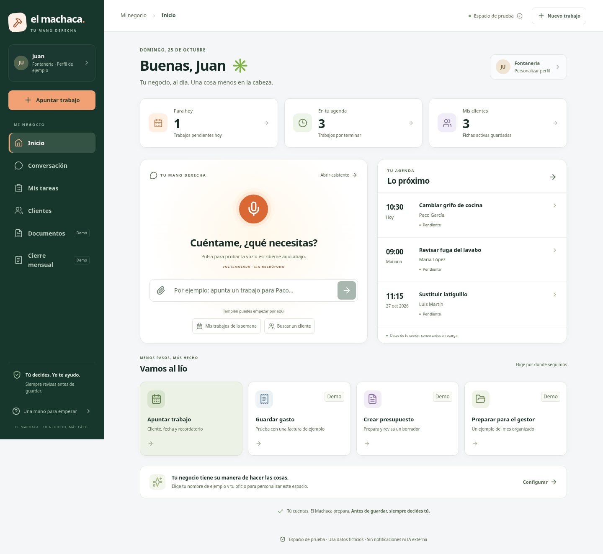
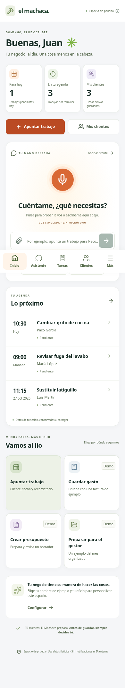

# El Machaca — demostración navegable

Esta rama contiene una vista pública separada para poder revisar la interfaz sin acceder al servidor privado.

La demo reutiliza las pantallas reales de la aplicación Next.js. Un adaptador de navegador sustituye la API por datos ficticios en memoria. Se pueden recorrer clientes, trabajos, revisión, agenda, asistente y ejemplos de documentos. Todo se reinicia al recargar. No contiene SQLite, cookies, claves, información personal real ni servicios de pago.

`index.html`, `styles.css` y `bundle.js` forman la demo estática. Esta rama no sustituye al proyecto Next.js/SQLite de desarrollo ni constituye un despliegue de producción.

## Abrir la demostración

[Abrir El Machaca en el navegador](https://livecodes.io/?mode=result#config=code%2FN4IgLglmA2CmIC4QFFoAICyBDAxgC1yzQHa0A1CAZzCIDssA3WAcywCM4QAaEPMAW2gBBMGABOlRKGhZazRCFiSAvj35YxAawCuABykgZc7VmbwkfQdxA4A9rTCwHCgDwATCAzQQ3AXgA6IGK2tmCBaNQAnnABIPwQtAC0eLAQzHwIAIwADNkMeIEAfO6eEWDRsLEAZvZgWQBsugAeAPSZAHQA7BGR1LD8idoQANy6WG4ecggAzNnNRS54mYVCbGIQTm62aKiYuAQ4WIBkBC4tS8W6hQAi-bbUYrgQAM%2B0aHavblhgd2hVEDiQHAQO7tNAAGR%2Bh34bGBlAisDQYlStH%2BEFkaCw6CRhzErDE7VOlxcRDwSKqsT4YF0lAQLRaDwA7u1mFA8No2NpKLAxO9HA52nZ%2BPT2U4xgAvO6ZTKJNzBHwtDiyTSJLC6XQtACsnSqnQAnFhOp83BrsgAmWBsXW6zpYAAcsH10w1WvqmSqWEy0ydUttWpauiRDA2DMS1C%2B-397OgEawlC5YEoLTcSk03107V0cnCNFxsDAsQA%2BoraJpwkjoLFaCFdE5uUUAMoQNBVt4aVhcNBMMRoWDoDxcgCPtlOWGKSc8Y48DEKIFUICinAQ0lkzBMZgUODj1l5TjACgAAhB%2BLpbGIwGhtGJoAAKADklOptJaODctHaACtKMnowx8bQ8y06TCmwopYBKlBSjKcpuAqRjKqquj7tkOr6shOD1M6sBumweo4FUto6h6OAACzZLqBFsGabidJksC2rqmT%2BoGwahjQgKRhwEYLkoApxreACUwyzjwlA4Osuh7kuhgrmu5ggO%2BjCxmJEASdutS7hu9jUBEvhbDg2j8LuApIl8sCoP0u53qJ4lgAJwyUO0lA8hSoiPnSL5vp%2B36eH%2BAFAWIIq0OKkrSrKtjysW8FqkhKFYGhGEalhVQ4bqeEETamQkWRFFUTRdEMUxsBBrAIZhuxuhRhGHK0G4cAfpQgT2e09jcsEYi%2BNe-G%2BIUwB6QZRkAI7aNykT1r2sAAqed4AMTBKEAntAkXJnkIbgKTgu4ABIACoYGCd4gTUSKbLeXC3i4uhlBUsRjBMCTMAgppzE0RQAHLbFyaAVVsra4hoaAyGgyb8LYoKrEiANEIcEmXkQ349rQMgbRiDjcsC%2BKEoUAnKMMfWGfybC2G4kTtAhmwAMJ4BA0BuNelCCcJcRE3JSKUNo0B7jw3y2NAkhSU47BwG4iAANoALoiWxnIKFW-6MwyvaCuY7q87AyhAA)

El visor externo carga los archivos públicos de esta rama. No necesita cuenta ni instalación. Usa únicamente datos ficticios; al recargar se reinicia.

## Capturas reales

